<div align="center">

# nsx

### Let agents build. Keep the bound, the budget and the last word.

The LangDrift CLI plans, runs and records a bounded execution around your own software, from your terminal.

<p align="center">
  <a href="https://langdrift.md/en/platform/cli/">Docs</a>
  ·
  <a href="https://langdrift.md/">LangDrift</a>
  ·
  <a href="https://github.com/jonatassales/nsx/blob/main/CHANGELOG.md">Changelog</a>
  ·
  <a href="https://github.com/jonatassales/nsx/blob/main/CONTRIBUTING.md">Contribute</a>
</p>

</div>



<p align="center">
  <a href="https://paladini.io/harness-score/guide/maturity-model.html"></a>
  <a href="https://github.com/jonatassales/nsx/actions/workflows/main.yml"></a>
  <a href="https://www.npmjs.com/package/@langdrift/nsx"></a>
  <a href="https://github.com/jonatassales/nsx/tags"></a>
  <a href="https://github.com/jonatassales/nsx/blob/main/LICENSE"></a>
  
</p>

## A run with edges

A coding agent can turn a ticket into a pull request. What it will cost, how much of your machine it takes and who agreed to it are usually answered afterwards, if at all.

nsx answers them first. It reads the ticket, sizes a **microruntime** for it inside the limits your team wrote down, prices the run before the first paid call, and waits for your team's go. Then it runs the stages, records what happened, and takes down what it brought up.

- **Bounded by your team.** The cpu, the memory and the budget per run come from your design doc. nsx sizes inside them and never sets them.
- **Priced before it is paid.** An estimate and a reservation come before the first model call; a run that does not fit its budget pauses at the gate.
- **Unknown is never zero.** Missing evidence reads as missing, never as zero spend or a confirmed stop.
- **A suggestion is not a decision.** nsx suggests a model and an effort. Your team's authorization decides.

## Three commands

| Command | What it does |
| --- | --- |
| `nsx init` | Lays down `.langdrift/` in your project: the guardrail, the prices, the workflow and the skills a run follows. |
| `nsx agent plan <ticket>` | Reads the ticket and its linked documents, sizes the components inside your bound and proposes the plan. Nothing is built, started or paid for. |
| `nsx agent run` | Applies the plan your team authorized: estimate, gate, stages, a local runtime, a pull request, and the record of all of it. |

**[Everything nsx does, line by line, is in the docs →](https://langdrift.md/en/platform/cli/)**

## Get started

```bash
pnpm add --global @langdrift/nsx
```

```bash
nsx init
```

```bash
nsx agent plan <ticket>
```

```bash
nsx agent run
```

nsx runs on macOS and Linux, on x64 and arm64. A run drives the tools already on your machine: your coding agent, `git` and `gh`, and Docker with `kind` and `kubectl` for the local runtime.

## What a run leaves

Three records, each written as the session goes: `plan.json`, `intent.json` and `run.json`. Their shapes are public JSON Schemas, shipped in this package, so the LangDrift console and your own tools read the same contract. [`schema/`](https://github.com/jonatassales/nsx/blob/main/schema/README.md) lists them.

## Environment

The variables nsx reads, by key.

| Key | Used by |
| --- | --- |
| `LANGDRIFT_SECRET`, `MCP_CONSOLE_URL` | `nsx init`, to record the project's connection to the LangDrift console in a private file Git does not track |
| `PATH`, `HOME`, `TMPDIR`, `LANG`, `LC_ALL`, `LC_CTYPE`, `LC_MESSAGES` | every program nsx starts |
| `SSH_AUTH_SOCK`, `GH_TOKEN`, `GITHUB_TOKEN`, `GH_HOST`, `XDG_CONFIG_HOME` | `git` and `gh`, for the delivery |
| `DOCKER_HOST`, `XDG_CONFIG_HOME`, `XDG_RUNTIME_DIR` | `kind`, `kubectl` and Docker, for the local runtime |
| the names in `passEnv` of `driver.json` | your coding agent |

nsx gives the coding agent its own: `LANGDRIFT_PROJECT_ROOT`, `LANGDRIFT_RUN`, `LANGDRIFT_TICKET`, `LANGDRIFT_STAGE`, `LANGDRIFT_SKILL`, `LANGDRIFT_MODEL`, `LANGDRIFT_EFFORT` and `LANGDRIFT_REPORT`. No other variable reaches a program nsx starts.

## Built under a harness

nsx is written in Rust and held to its own rules: every change passes `vtec`, this repository's guardrails for commits and code, before it merges, and each binary is built on `main` with a signed build provenance attestation.

- [Contributing](https://github.com/jonatassales/nsx/blob/main/CONTRIBUTING.md)
- [Architecture](https://github.com/jonatassales/nsx/blob/main/docs/architecture.guide.md): where each line of the session lives in `src/`
- [Security](https://github.com/jonatassales/nsx/blob/main/SECURITY.md)

---

**From vision to reality, and everything in between.**  
Made in Brazil · [Neongate AI](https://neongate.com.br/) · [Apache-2.0](https://github.com/jonatassales/nsx/blob/main/LICENSE)
